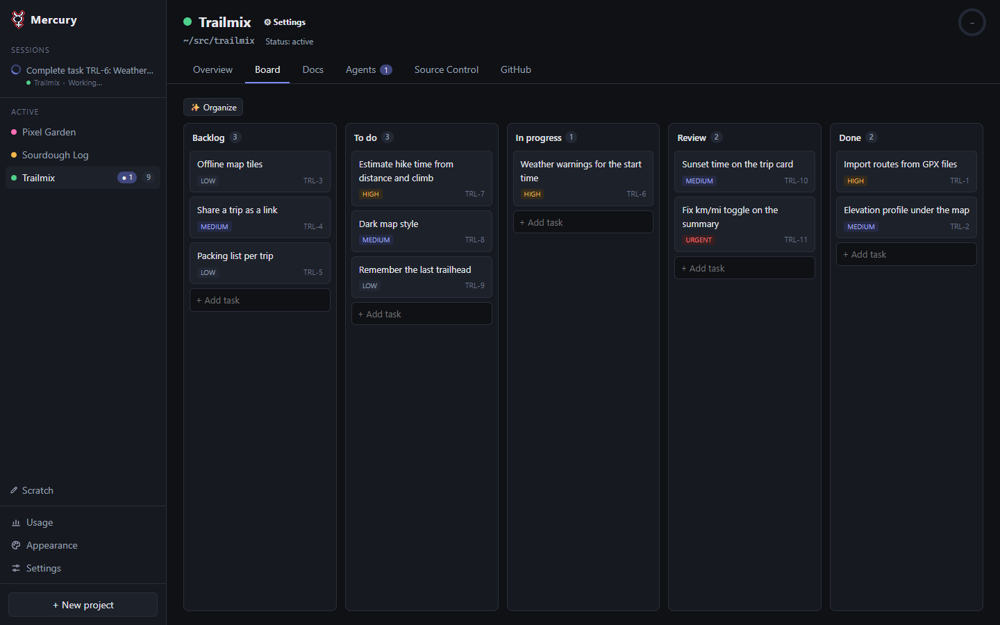
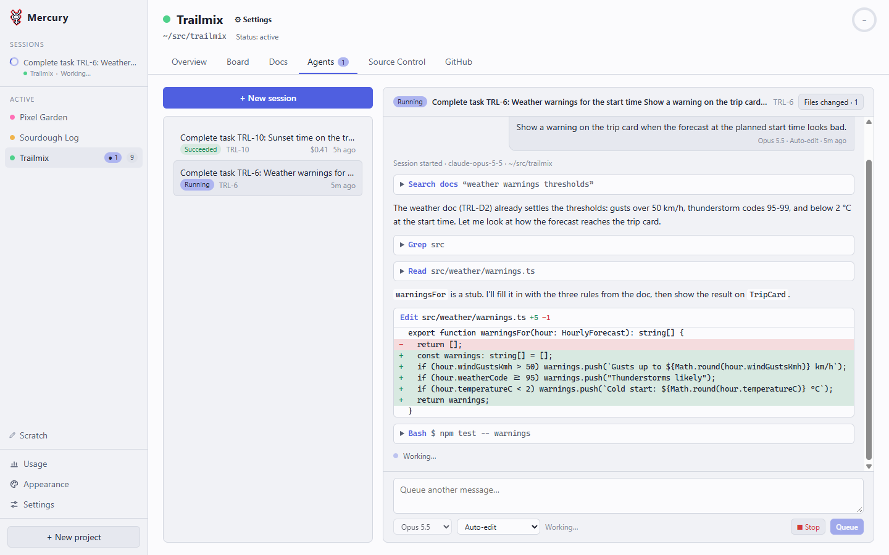
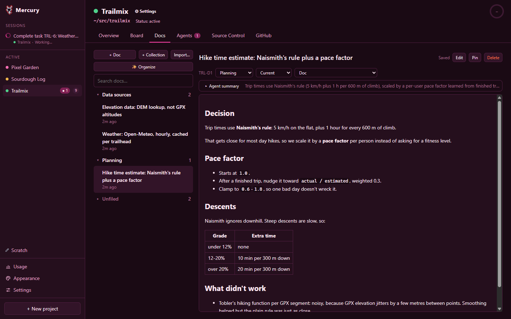

# Mercury

A desktop app I use to keep track of my projects. Every project gets a board, docs, and Claude agents that work right in the repo.



<p>
  
  
</p>

## What's in it

- **Projects**: point one at a local git repo. It picks up the GitHub repo from `origin`.
- **Board**: kanban for tasks. Hand a task to an agent and it moves itself along the board as the agent works on it.
- **Docs**: the project's memory. Agents read and write them as they go, so they don't start from zero every time. Search is local (keywords + a small embedding model).
- **Agents**: Claude Code sessions through the Agent SDK. Pick how much they can do without asking, approve stuff in the transcript, send messages while they work.
- **✨ Organize**: lets an agent clean up the board or docs so I don't have to.
- **Source Control**: basically VS Code's git panel. It can write commit messages too.
- **GitHub**: open PRs and issues, and can sync issues onto the board. Uses `gh`.
- **Scratch**: a catch-all project for sessions that don't belong anywhere.
- Plus settings, themes, and a usage gauge so I know when I'm about to hit my limit.

## Running it

You need Python 3.10+, Node 20+, git, and either a Claude Code login or `ANTHROPIC_API_KEY`. `gh` is optional (only the GitHub tab needs it).

```bash
npm run setup   # once
npm run dev     # Vite + Electron, backend on :8765
npm start       # built version
npm test        # backend tests + typecheck
```

Data lives in `~/.mercury`.

## How it's built

- `desktop/`: Electron. Starts the backend and opens the window.
- `frontend/`: React + TypeScript + Vite.
- `backend/`: FastAPI + SQLite + `claude-agent-sdk`.

The backend only listens on `127.0.0.1` and rejects unknown origins, since it can run code on your machine.

## Config

All optional.

| Variable | Default | What it does |
|---|---|---|
| `MERCURY_DATA_DIR` | `~/.mercury` | Where the database goes |
| `MERCURY_PORT` | `8765` (dev) / random (app) | Backend port |
| `MERCURY_AGENT_MODEL` | `claude-opus-5-5` | Default agent model |
| `MERCURY_COMMIT_MESSAGE_MODEL` | `claude-haiku-5-5` | Writes commit messages |
| `MERCURY_DOC_SUMMARY_MODEL` | `claude-haiku-5-5` | Writes doc summaries |
| `MERCURY_DOC_SUMMARIES` | `1` | `0` turns off background doc summaries |
| `MERCURY_EMBEDDINGS` | `1` | `0` for keyword-only doc search |
| `MERCURY_EMBEDDING_MODEL` | `BAAI/bge-small-en-v1.5` | Embedding model for doc search |
| `MERCURY_EMBEDDING_THREADS` | `4` | CPU threads for embedding |
| `MERCURY_PYTHON` | `backend/.venv` python | Python Electron uses for the backend |
| `MERCURY_ALLOWED_ORIGINS` | none | Extra allowed origins, comma-separated |

## Maybe someday

- A real installer
- Each agent run in its own git worktree so they don't step on each other
